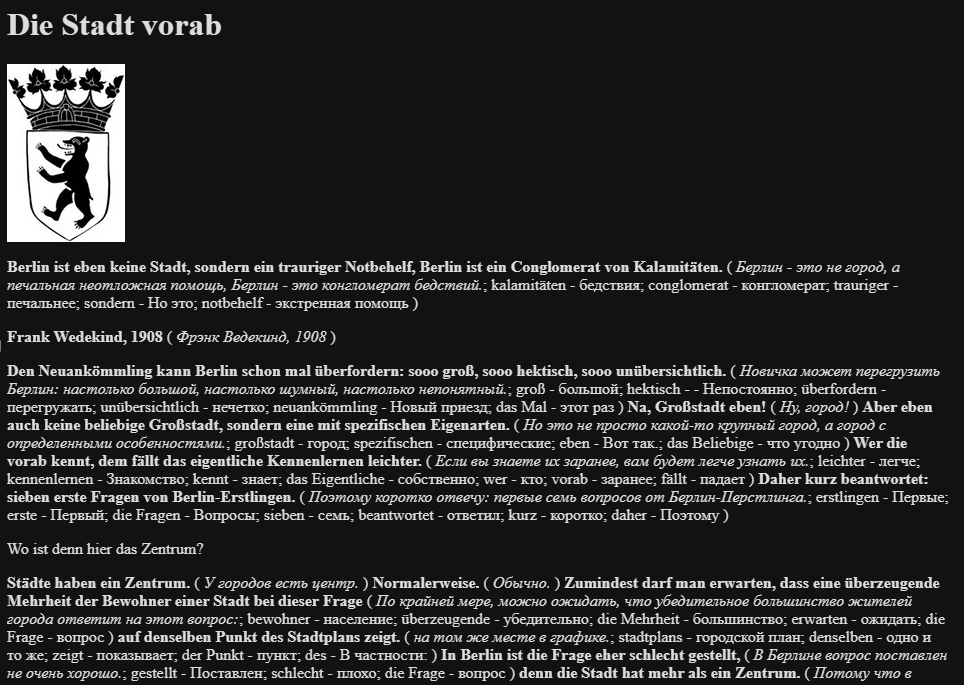
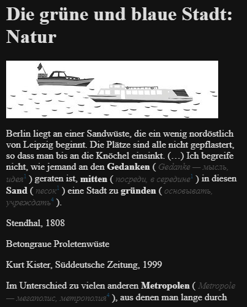
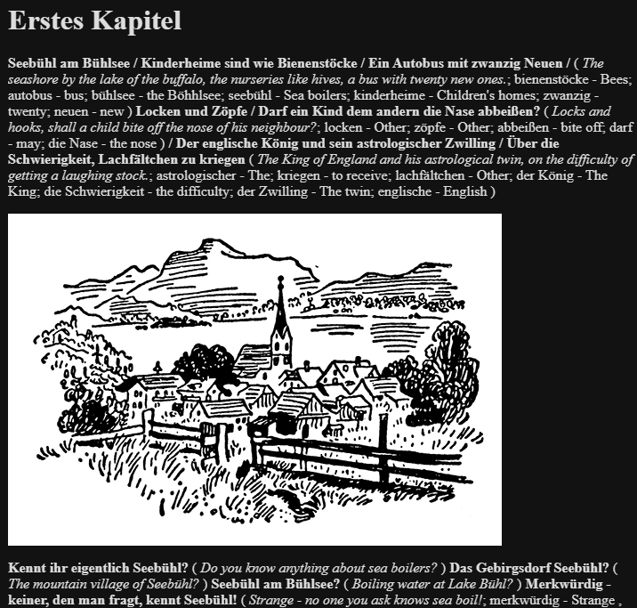

# 🇩🇪→🇷🇺 German to Bilingual German-Russian EPUB Translator

This tool is built for language learners and enthusiasts who want to convert German-language EPUB files into bilingual German-Russian format. Each sentence is followed by a partial translation, with key words and phrases explained in Russian. This method naturally enhances comprehension and expands vocabulary through context.

**Default behavior:** **German in → German-Russian EPUB out**  
Other language pairs can be configured via parameters.

---

## 📘 `book_nllb.py` — Main Translation Script


This script converts German EPUBs into bilingual German-Russian EPUBs using:

- **Meta’s NLLB** for machine translation  
- **KeyBERT** for keyword extraction  
- Inline translation to support contextual learning

> 💡 Tip: Use **VS Code** with a **devcontainer** for a consistent development environment.  
> Alternatively, use the traditional workflow:

```bash
uv venv
.venv\Scripts\activate  # On Windows
uv pip install .
python book_nllb.py input.epub output.epub
```



---

## 🗃️ `convert_sqlite.py` — Vocabulary Support Script

This script loads German nouns from a JSON file into an SQLite database.  
It's useful in combination with `book_nllb.py` for word lookups and vocabulary review.

Reference file:  
[german_nouns_output.json](https://github.com/Hanttone/der-die-das-game/blob/master/data/german_nouns_output.json)

---

## 🤖 `book_gemma.py` — Experimental Translation Script

An alternative translation method using **Gemma 3** via **Ollama**.

- Outputs bilingual German-Russian translation in JSON format
- Generates word frequency statistics
- Allows filtering and selective translation
- Designed for experimentation; not optimized for production use

> ⚠️ Demo code only — no setup or containerization included.

---

## 📖 `book_vocab_tracker.py` — Adaptive Vocabulary Tracker

Annotates a German EPUB with inline vocabulary glosses from a word list (e.g. Goethe B1).  
No translation of sentences — only the words you want to learn, exactly where they appear.

**How it works:**

- Each word from the vocabulary list is annotated inline: **Gedanken** ( *Gedanke — мысль, идея*¹ )
- The superscript shows which occurrence of that word this is (¹ first time, ² second, … up to ⁹)
- A word is re-annotated at most every **N words** (default 100) to avoid repetition clutter
- When the word appears in an inflected form, the base form is shown: **gründen** ( *основывать*¹ )
- German noun articles are detected automatically via spaCy: **Metropole** ( *die Metropole — мегаполис*¹ )
- A final chapter is appended with an **alphabetical glossary** and a **coverage summary** (words found in black, words not found in red)

**Vocabulary file:** `vocab_b1_goethe_full.tsv` — 1 467 lemmas from the official Goethe-Zertifikat B1 word list with Russian translations.

```bash
python book_vocab_tracker.py input.epub output.epub --vocab vocab_b1_goethe_full.tsv

# or use the batch file on Windows:
run_vocab_tracker.bat input.epub
```

| Option | Default | Description |
|--------|---------|-------------|
| `--vocab` | `vocab_b1_goethe_full.tsv` | Path to TSV vocabulary file |
| `--interval` | `100` | Min words between two annotations of the same word |
| `--max` | `9` | Max annotations per word across the whole book |



---

## 📦 Executable Release

A standalone executable version is available for Windows, macOS, and Linux.  
No need to install Python or any dependencies.

### Download

Grab the latest executable from the [Releases](https://github.com/konyshevgmbh/epub-bilingual-penetration/releases) page.

### Usage

```bash
# Windows
epub-bilingual-translator.exe input.epub output.epub

# macOS/Linux
./epub-bilingual-translator input.epub output.epub
```

Example with language override:

```bash
epub-bilingual-translator.exe --tgt-lang eng_Latn in.epub out.epub
```



---

## 🌐 Available Languages

See all supported languages for each model family here:  
https://dl-translate.readthedocs.io/en/latest/available_languages/

---

### 🔧 Build the Executable Yourself

If you'd rather build it manually:

1. On Windows: run `build_executable.bat`  
2. On macOS/Linux: run `./build_executable.sh`  
   (Make it executable first: `chmod +x build_executable.sh`)

For release instructions, see [RELEASE_INSTRUCTIONS.md](RELEASE_INSTRUCTIONS.md).

### 🛠️ Tips ###
*   Use `uv` for fast environment setup (`uv venv && uv sync`).
*   Use VS Code Dev Containers for a pre-built environment.
*   Setup your huggegingface token
*   PyTorch inside the container works smoothly with CUDA if the GPU supports it. Locally, you might need to tweak drivers and versions.
---

Pull requests are welcome. Suggestions appreciated.  
Yes, there might be a bug or two — feel free to point them out.

### See also: ###
* [Lingtrain Aligner is a powerful, ML-powered library for accurately aligning texts in different languages](https://github.com/averkij/lingtrain-aligner)
* [bilingual_book_maker - Make bilingual epub books using AI translate (GPT-4, Claude, Gemini)](https://github.com/yihong0618/bilingual_book_maker)
* [epub-translator - Use LLM to losslessly translate EPUB e-books, retain the original layout](https://github.com/oomol-lab/epub-translator)
* [biBooks - Create bilingual e-books using alignment of language agnostic sentence vectors](https://github.com/pschonev/biBooks)
* [Moerkepub - Local EPUB translation using multilingual Transformer models on GPU](https://github.com/BLCK-B/Moerkepub)
* [make-parallel-text - Make parallel text ebook from two translations for language learning](https://github.com/sowcow/make-parallel-text)
* [Ebook-Translator-Calibre-Plugin - Calibre plugin to translate ebooks (Google Translate, ChatGPT, DeepL)](https://github.com/bookfere/Ebook-Translator-Calibre-Plugin)
* [jorkens - EPUB reader for foreign language learners with dictionary integration](https://github.com/mcthulhu/jorkens)

